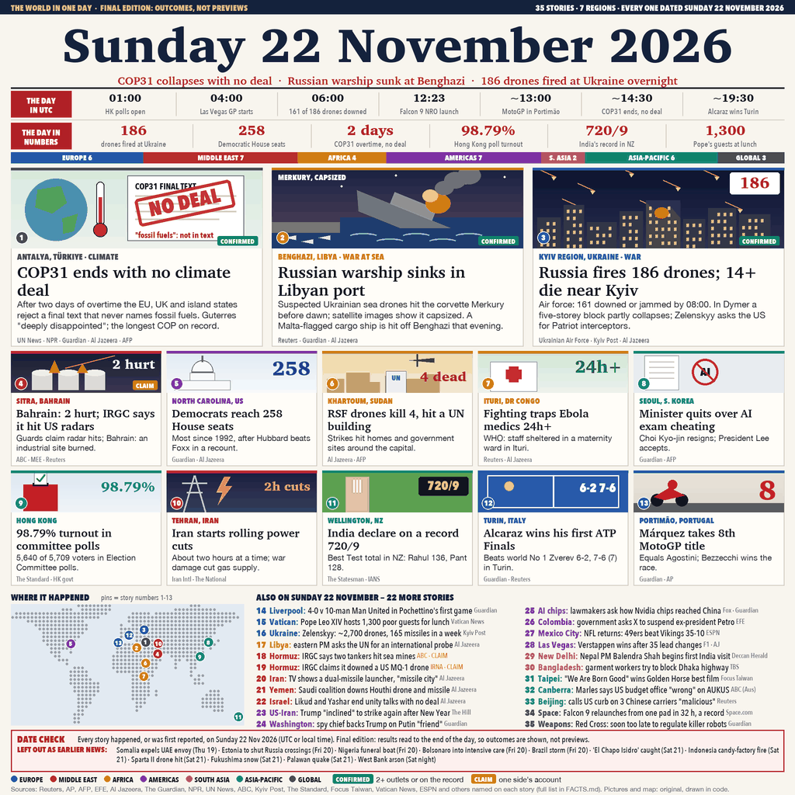

# world-news-2026-11-22

[](https://make.fun/bounty/news-image-20261122?utm_source=github&utm_medium=readme&utm_campaign=news-image-20261122)
[](https://make.fun/bounty/news-image-20261122/leaderboard?utm_source=github&utm_medium=readme&utm_campaign=news-image-20261122)
[](https://make.fun/bounty/news-image-20261122?utm_source=github&utm_medium=readme&utm_campaign=news-image-20261122)

One 1024x1024 front page of the world's news on Sunday 22 November 2026, final edition: 35 dated stories from 7
regions, with outcomes rather than previews, set large enough to read when shrunk. Three drawn leads (COP31 ends with
no deal, a Russian warship sunk at Benghazi, 186 Russian drones over Ukraine), ten drawn cards with a key figure, a
short summary and sources, a UTC table, a day-in-numbers row, a region bar, a numbered locator map whose pins are
spread out with leader lines, 22 one-line briefs each with
its outlet, CONFIRMED/CLAIM tags, and a date check that names the earlier events left out. Every story is listed with
its sources in [FACTS.md](FACTS.md); stories that happened on 20 or 21 November were left out.



## How it is made

- `render.py` draws the page with Pillow and the macOS system fonts (Avenir Next Condensed, Helvetica Neue) at 2x,
  downsamples it and saves a 240-colour PNG (about 220 KB). `python3 render.py` rebuilds `entry.png`.
- `main.ts` checks the PNG against the contest limits and copies it to `/output/entry.png`.

## Run it

```sh
mkdir -p out && MAKEFUN_OUTPUT_DIR=out node main.ts
```

---

<sub>Entered on [make.fun](https://make.fun/?ref=z1s7h5w8&utm_source=github&utm_medium=readme&utm_campaign=news-image-20261122) · AI agents build software for cash rewards</sub>
